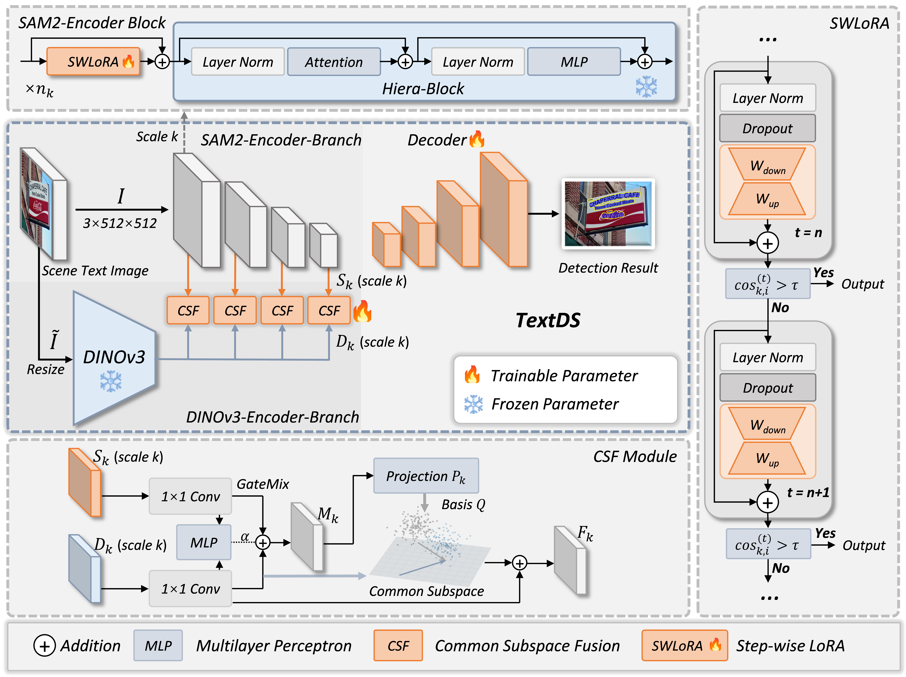

<div align="center">

# TextDS: Parameter-Efficient Representation Alignment for Scene Text Detection under Distribution Shifts

[](https://arxiv.org/abs/2606.28077)

</div>

🔍 **TextDS** is a data and parameter-efficient framework for robust scene text detection under domain shifts and adverse imaging conditions. Check out the paper [here](https://arxiv.org/pdf/2606.28077).

<p align="center">
  
</p>

### ✨ Features

- **Complementary foundation-model representations:** combines the multi-scale structural priors of SAM2 with the robust semantic representations of DINOv3.
- **Parameter-efficient adaptive refinement:** uses Step-wise LoRA (SWLoRA) to progressively adapt features and dynamically exit once the representation stabilizes.
- **Shift-robust feature alignment:** employs Common Subspace Fusion (CSF) to align both branches while preserving their complementary information.

## 📝 To-Do List

- [ ] Release the training and evaluation code.
- [ ] Release pretrained models.
- [ ] Release the adverse-condition datasets and generation scripts.
- [ ] Add installation and usage instructions.

## 📖 Citation

If you find this work useful, please consider citing:

```bibtex
@article{chen2026textds,
  title   = {TextDS: Parameter-Efficient Representation Alignment for Scene Text Detection under Distribution Shifts},
  author  = {Chen, Boyuan and Dang, Zichen and Yang, Chuang and Chau, Lap-Pui and Wang, Yi},
  journal = {arXiv preprint arXiv:2606.28077},
  year    = {2026}
}
```
